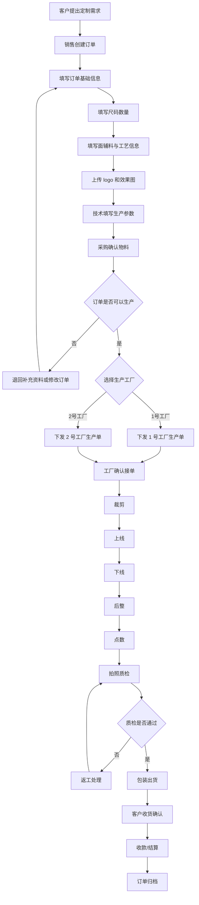
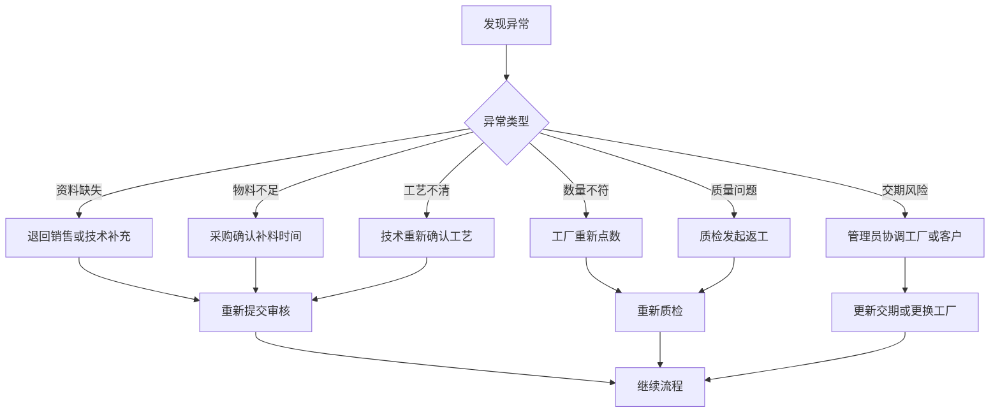

# 服装定制下单与工厂流转系统 LOOP

## 1. 项目定位

本系统面向服装定制厂家，用于管理客户下单后的完整业务闭环：客户订单录入、订单资料确认、可生产订单分配给 1 号工厂或 2 号工厂、生产节点跟踪、质检拍照、数量点数、出货确认、收款与复盘。

系统目标不是做普通电商下单，而是服务“定制服装生产协同”。每一笔订单都需要记录尺寸、面料、辅料、工艺、logo、技术参数、生产节点和责任人，确保客户、销售、技术、采购、工厂、财务都能围绕同一张订单协作。

## 2. 核心角色

| 角色 | 主要职责 |
| --- | --- |
| 客户 | 提供定制需求、尺码数量、logo、交期、收货信息，确认样稿和成品 |
| 销售 | 创建客户订单，跟进客户需求，确认价格、交期、回款 |
| 技术 | 填写技术参数、工艺要求、面辅料规格、生产注意事项 |
| 采购 | 确认面料、辅料、库存、采购到料时间 |
| 管理员 | 审核订单是否可以下发工厂，选择 1 号工厂或 2 号工厂 |
| 工厂 | 接收生产单，完成裁剪、上线、下线、后整、包装、出货 |
| 质检 | 点数、拍照、检查质量问题，确认是否允许出货 |
| 财务 | 确认订金、尾款、工厂结算、订单利润 |

## 3. 订单主流程 LOOP



## 4. 订单状态闭环

订单必须有明确状态，系统所有页面、筛选、权限和提醒都围绕状态流转。

| 状态 | 说明 | 可操作角色 |
| --- | --- | --- |
| 草稿 | 销售正在录入订单，未提交审核 | 销售 |
| 待资料完善 | 订单信息不完整，需要补充技术、logo、尺码、物料等 | 销售、技术、采购 |
| 待审核 | 资料已提交，等待管理员判断是否可下发 | 管理员 |
| 待分厂 | 订单可以生产，但还未指定 1 号或 2 号工厂 | 管理员 |
| 已下发工厂 | 订单已经分配给指定工厂 | 管理员、工厂 |
| 工厂已接单 | 工厂确认可以生产 | 工厂 |
| 生产中 | 已进入裁剪、上线、下线或后整任一环节 | 工厂 |
| 待质检 | 生产完成，等待点数、拍照、质检 | 质检 |
| 返工中 | 质检不通过，需要工厂返工 | 工厂、质检 |
| 待出货 | 质检通过，等待包装或物流 | 工厂、销售 |
| 已出货 | 已发货并记录物流信息 | 销售、工厂 |
| 已完成 | 客户确认收货，财务结算完成 | 销售、财务 |
| 已取消 | 客户取消或订单作废 | 管理员 |

## 5. 订单信息结构

### 5.1 订单基础信息

| 字段 | 说明 |
| --- | --- |
| 订单编号 | 系统自动生成，唯一 |
| 客户名称 | 公司、学校、团队或个人客户 |
| 联系人 | 客户联系人 |
| 联系电话 | 客户电话 |
| 销售负责人 | 跟单销售 |
| 下单日期 | 客户确认下单日期 |
| 计划交期 | 预计交货日期 |
| 订单类型 | 工作服、校服、团服、冲锋衣、Polo、T 恤等 |
| 紧急程度 | 普通、加急、特急 |
| 订单来源 | 微信、电话、线下、老客户、平台 |
| 备注 | 其他说明 |

### 5.2 尺码数量

尺码数量需要支持多产品、多尺码、多行录入。

| 字段 | 示例 |
| --- | --- |
| 产品 | 单衣、裤子、套装、马甲 |
| 150 | 数量 |
| 155 | 数量 |
| 160 | 数量 |
| 165 | 数量 |
| 170 | 数量 |
| 175 | 数量 |
| 180 | 数量 |
| 185 | 数量 |
| 190 | 数量 |
| 195 | 数量 |
| 200 | 数量 |
| 特体 | 特殊体型数量 |
| 合计数量 | 系统自动计算 |

规则：

- 每一行代表一个产品。
- 每个尺码只能填写非负整数。
- 合计数量由系统自动汇总。
- 订单总数量等于全部产品行合计。

### 5.3 面辅料信息

| 字段 | 说明 |
| --- | --- |
| 面料主色 | 主体颜色 |
| 面料拼色 | 拼接颜色 |
| 里布 | 里布规格 |
| 填充物 | 棉、羽绒、无填充等 |
| 省布 | 是否需要省布或特殊裁剪 |
| 面料备注 | 克重、成分、供应商、库存说明 |

### 5.4 辅料信息

| 字段 | 说明 |
| --- | --- |
| 门襟拉链 | 拉链类型、颜色、规格 |
| 辅料 | 常规辅料说明 |
| 扣子分类 | 四合扣、纽扣、魔术贴等 |
| 反光条 | 位置、宽度、颜色 |
| 缝纫线 | 线色、线号 |
| 松紧 | 袖口、下摆、裤腰等 |
| 商标 | 主标、洗水标、尺码标 |
| 吊牌 | 是否需要、吊牌内容 |

### 5.5 定制内容

| 字段 | 说明 |
| --- | --- |
| 定制类型 | 刺绣、印花、热转印、织唛、章仔 |
| 定制内容 | 公司名、logo、姓名、编号等 |
| 定制位置 | 左胸、右胸、后背、袖子、裤腿等 |
| logo 文件 | 支持图片、AI、CDR、PDF 等 |
| 效果图 | 客户确认图或生产参考图 |
| 技术图片 | 工艺细节、车缝位置、尺寸图 |

## 6. 分配工厂规则

管理员审核订单后，必须选择 1 号工厂或 2 号工厂。系统需要记录分配理由，方便后期追溯。

| 判断项 | 说明 |
| --- | --- |
| 工厂产能 | 当前工厂是否有空档 |
| 擅长品类 | 例如 1 号工厂擅长工作服，2 号工厂擅长校服或冲锋衣 |
| 交期压力 | 哪个工厂能按时交付 |
| 工艺能力 | 是否支持刺绣、压胶、反光条、特殊面料 |
| 历史质量 | 同类订单过往返工率和投诉率 |
| 成本 | 工厂报价、运输成本、返工成本 |

分配动作必须记录：

- 分配时间
- 分配人
- 被分配工厂
- 分配理由
- 工厂接单确认时间

## 7. 工厂生产节点

每个工厂接单后，按照统一节点推进。

| 节点 | 说明 | 状态 |
| --- | --- | --- |
| 工厂接单 | 工厂确认订单资料完整，可以生产 | 未开始/已确认 |
| 裁剪 | 开始裁片 | 未开始/进行中/已完成 |
| 上线 | 进入车间缝制 | 未开始/进行中/已完成 |
| 下线 | 缝制完成 | 未开始/进行中/已完成 |
| 后整 | 整烫、剪线、修整 | 未开始/进行中/已完成 |
| 点数 | 按尺码和产品核对数量 | 未开始/通过/异常 |
| 拍照 | 上传成品图、细节图、包装图 | 未上传/已上传 |
| 质检 | 检查质量和数量 | 未检/通过/返工 |
| 包装 | 正常包装、贴标、装箱 | 未开始/已完成 |
| 出货 | 物流发出 | 未出货/已出货 |

## 8. 异常处理 LOOP



异常必须记录：

- 异常类型
- 异常描述
- 责任角色
- 处理人
- 处理结果
- 处理时间
- 相关图片或附件

## 9. 核心页面

| 页面 | 功能 |
| --- | --- |
| 订单列表 | 查看全部订单，按状态、客户、工厂、交期筛选 |
| 新建订单 | 录入基础信息、尺码数量、面辅料、工艺、logo |
| 订单详情 | 查看订单完整资料、流程进度、附件、备注 |
| 审核中心 | 管理员审核订单是否可以生产 |
| 分厂页面 | 将订单分配给 1 号工厂或 2 号工厂 |
| 工厂工作台 | 工厂查看被分配的订单和生产节点 |
| 生产进度看板 | 显示裁剪、上线、下线、后整、质检、出货状态 |
| 点数质检页面 | 核对尺码数量、上传质检图、标记异常 |
| 财务结算页面 | 记录订金、尾款、工厂成本、利润 |
| 数据统计页面 | 统计订单量、工厂交付率、返工率、利润 |

## 10. 9 分订单评分系统

系统内置“订单可生产评分”，满分 10 分。管理员只有在订单达到 9 分及以上时，才允许下发给 1 号工厂或 2 号工厂。低于 9 分的订单必须补充资料、重新评分，不能强行流入生产。

### 10.1 评分目标

评分不是评价销售人员，而是判断订单资料是否足够清晰、生产风险是否可控、工厂是否能按要求交付。

### 10.2 评分项

| 评分项 | 分值 | 达标标准 |
| --- | ---: | --- |
| 客户与交期信息 | 1.0 | 客户、联系人、电话、下单日期、计划交期完整 |
| 尺码数量 | 1.5 | 至少 1 个产品，尺码数量合计大于 0，合计自动计算无异常 |
| 面料信息 | 1.2 | 主色、拼色或里布、填充物、面料备注中至少关键项清楚 |
| 辅料信息 | 1.0 | 拉链、扣子、反光条、缝纫线、商标、吊牌等关键辅料明确 |
| 定制内容 | 1.0 | 定制类型、内容、位置、logo 或效果图明确 |
| 技术参数 | 1.2 | 技术负责人已确认工艺、尺寸、特殊要求和生产注意事项 |
| 采购确认 | 1.0 | 面辅料库存或采购到料时间已确认 |
| 工厂匹配 | 1.0 | 1 号或 2 号工厂的产能、品类、工艺能力与订单匹配 |
| 质量与交付风险 | 1.1 | 没有未处理异常，交期风险、质量风险、返工风险可控 |

### 10.3 分数解释

| 分数 | 系统判断 | 处理方式 |
| --- | --- | --- |
| 0 - 5.9 | 资料不足 | 不允许提交审核，必须补齐基础资料 |
| 6.0 - 7.9 | 可以内部讨论 | 可以保存和补充，但不能分厂 |
| 8.0 - 8.9 | 接近可生产 | 管理员可以审核，但必须补齐扣分项 |
| 9.0 - 10 | 可下发工厂 | 允许分配 1 号工厂或 2 号工厂 |

### 10.4 重做规则

如果订单低于 9 分，系统必须给出扣分原因。处理方式是：

1. 标记订单为“待资料完善”。
2. 自动生成缺失项清单。
3. 销售、技术、采购按责任补充资料。
4. 重新提交审核。
5. 系统重新计算评分。
6. 分数达到 9 分后才允许分厂。

### 10.5 9 分系统验收标准

开源项目本身也按照 10 分制验收。目标是达到 9 分以上。

| 模块 | 分值 | 标准 |
| --- | ---: | --- |
| 业务闭环完整度 | 2.0 | 订单、审核、分厂、生产、质检、出货闭环可跑通 |
| 数据结构清晰度 | 1.5 | 字段、状态、角色、操作日志结构清楚 |
| 页面可用性 | 1.5 | 不依赖说明书即可完成主要操作 |
| 状态与规则控制 | 1.5 | 关键节点有校验，低于 9 分不能下发 |
| 开源文档 | 1.0 | README、开发流程、评分规则、架构说明齐全 |
| 本地运行门槛 | 1.0 | 克隆后可以快速运行或直接打开 |
| 扩展性 | 1.0 | 后续可替换数据库、增加工厂、接入文件存储 |
| 视觉与交互质量 | 0.5 | 适合生产管理场景，信息密度高，操作清楚 |

低于 9 分的版本必须重做短板模块，不允许发布为正式版本。

## 11. 权限规则

| 操作 | 销售 | 技术 | 采购 | 管理员 | 工厂 | 质检 | 财务 |
| --- | --- | --- | --- | --- | --- | --- | --- |
| 创建订单 | 是 | 否 | 否 | 是 | 否 | 否 | 否 |
| 编辑客户信息 | 是 | 否 | 否 | 是 | 否 | 否 | 否 |
| 编辑技术参数 | 否 | 是 | 否 | 是 | 否 | 否 | 否 |
| 编辑采购信息 | 否 | 否 | 是 | 是 | 否 | 否 | 否 |
| 审核订单 | 否 | 否 | 否 | 是 | 否 | 否 | 否 |
| 分配工厂 | 否 | 否 | 否 | 是 | 否 | 否 | 否 |
| 更新生产节点 | 否 | 否 | 否 | 是 | 是 | 否 | 否 |
| 上传质检结果 | 否 | 否 | 否 | 是 | 否 | 是 | 否 |
| 查看财务数据 | 否 | 否 | 否 | 是 | 否 | 否 | 是 |

## 12. 最小可用版本 MVP

开源第一版先做最小可用，不追求一次性做完所有功能。

第一版必须包含：

- 登录和角色权限
- 客户管理
- 订单创建
- 尺码数量表
- 面辅料和工艺表
- logo/效果图/技术图上传
- 订单审核
- 分配 1 号工厂或 2 号工厂
- 工厂生产节点更新
- 点数和质检结果
- 订单状态流转
- 订单列表和筛选

第一版暂缓：

- 自动排产算法
- 复杂财务利润分析
- 手机 App
- 客户在线下单商城
- 供应商自动采购
- 工厂自动报价

## 13. 推荐数据表

| 表名 | 说明 |
| --- | --- |
| users | 系统用户 |
| roles | 角色 |
| customers | 客户 |
| orders | 订单主表 |
| order_items | 订单产品行 |
| order_size_quantities | 尺码数量 |
| order_materials | 面料信息 |
| order_accessories | 辅料信息 |
| order_customizations | 定制内容 |
| order_files | logo、效果图、技术图、质检图 |
| factories | 工厂 |
| factory_assignments | 工厂分配记录 |
| production_steps | 生产节点记录 |
| inspections | 点数和质检 |
| exceptions | 异常处理 |
| payments | 收款和结算 |
| operation_logs | 操作日志 |

## 14. 系统必须遵守的业务规则

1. 没有尺码数量，订单不能提交审核。
2. 没有计划交期，订单不能提交审核。
3. 没有技术参数，订单不能下发工厂。
4. 没有采购确认，订单不能下发工厂。
5. 订单必须分配到 1 号工厂或 2 号工厂后，工厂才能看到。
6. 工厂只能看到分配给自己的订单。
7. 工厂不能修改客户价格和财务信息。
8. 质检不通过时，订单不能出货。
9. 出货前必须完成点数。
10. 出货前必须上传至少一张成品或包装照片。
11. 所有关键操作都要写入操作日志。
12. 订单完成后不能随意修改，修改必须有管理员权限并保留日志。
13. 订单评分低于 9 分时不能下发工厂。
14. 低于 9 分的订单必须显示扣分原因。

## 15. AI 开发提示词

如果使用 AI 辅助开发，可以使用下面这段作为系统需求输入：

```text
请开发一个开源的服装定制订单管理系统。

业务背景：我是服装定制厂家，客户找我下单后，我需要把可生产的订单分配给 1 号工厂或 2 号工厂，并跟踪从订单录入、技术参数、采购确认、工厂生产、点数质检、拍照、出货、收款结算的完整闭环。

系统角色包括：销售、技术、采购、管理员、工厂、质检、财务。

核心流程：
客户需求 -> 销售创建订单 -> 填写订单基础信息 -> 填写尺码数量 -> 填写面料辅料和定制工艺 -> 上传 logo 和效果图 -> 技术填写生产参数 -> 采购确认物料 -> 管理员审核订单 -> 选择 1 号工厂或 2 号工厂 -> 工厂确认接单 -> 裁剪 -> 上线 -> 下线 -> 后整 -> 点数 -> 拍照质检 -> 包装出货 -> 客户确认 -> 财务结算 -> 订单归档。

订单必须包含：客户信息、订单编号、销售负责人、下单时间、计划交期、产品名称、尺码数量、面料主色、面料拼色、里布、填充物、门襟拉链、扣子分类、反光条、缝纫线、松紧、商标、吊牌、定制类型、定制内容、定制位置、logo 文件、效果图、备注。

系统需要实现状态流转、角色权限、订单列表筛选、工厂工作台、生产节点更新、异常处理、质检和出货限制。系统必须内置 10 分制订单评分，低于 9 分不能下发工厂，并展示扣分原因。

请先实现一个 Web 版本 MVP，适合作为 GitHub 开源项目。代码结构要清晰，README 要能说明如何本地运行、如何配置数据库、如何初始化默认角色和两个默认工厂。
```

## 16. 开源项目 README 简介草稿

```text
# 服装定制订单管理系统

一个面向服装定制厂家、加工厂和生产协同团队的开源订单管理系统。

它解决的问题是：客户下单后，厂家如何把订单资料、尺码数量、面辅料、logo、技术参数和生产要求整理成可生产订单，并分配给不同工厂跟踪生产进度。

核心功能：
- 客户订单录入
- 尺码数量管理
- 面辅料和定制工艺管理
- logo / 效果图 / 技术图上传
- 订单审核
- 1 号工厂 / 2 号工厂分配
- 工厂生产节点跟踪
- 点数、拍照、质检
- 出货和结算
- 角色权限和操作日志
```
