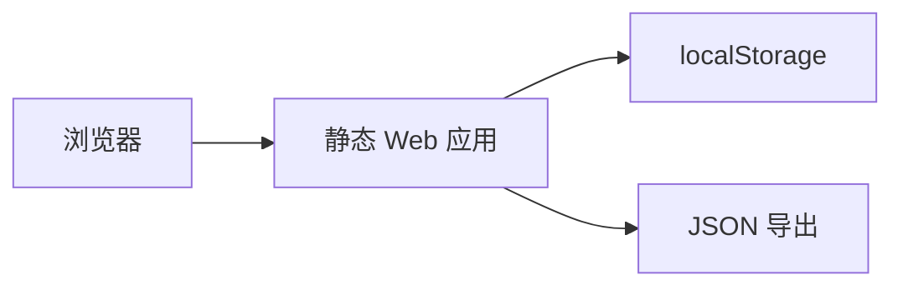
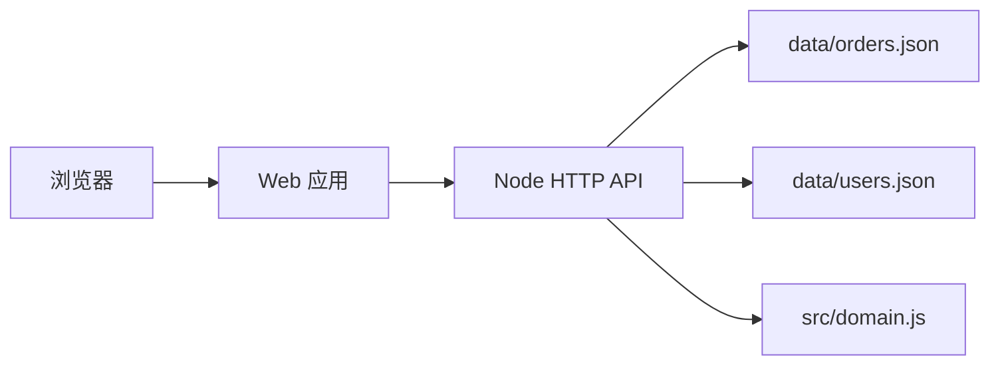
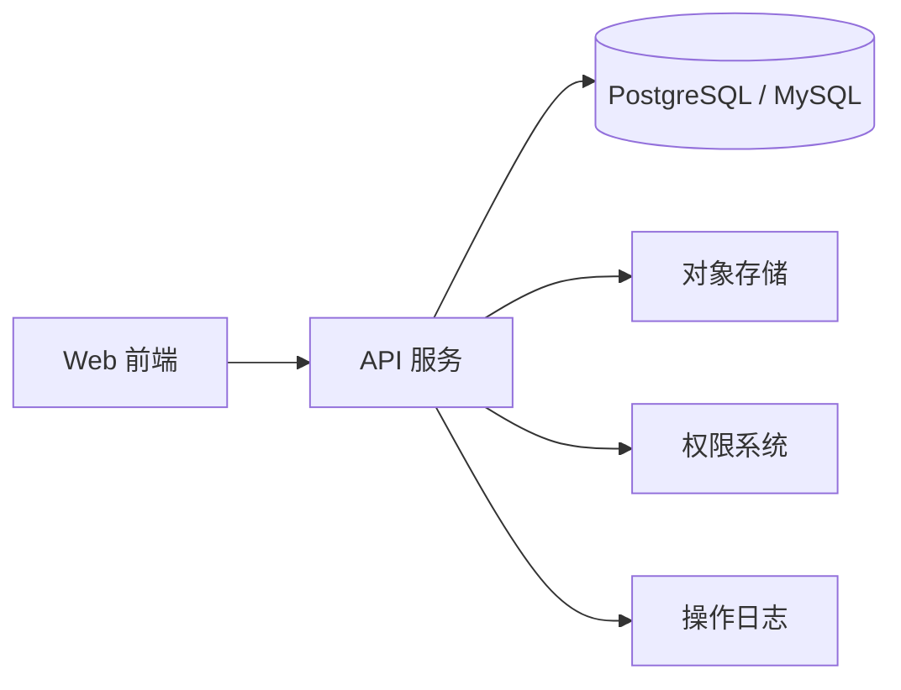

# 系统架构

## 1. 当前 MVP 架构

当前版本使用静态 Web 技术实现：

- `index.html`：应用入口
- `src/app.js`：状态、评分、业务动作、页面渲染
- `src/domain.js`：订单评分、状态门、分厂和出货规则
- `src/styles.css`：生产管理后台样式
- `tests/domain.test.js`：领域规则测试
- `scripts/quality-gate.js`：9 分验收脚本
- `localStorage`：本地数据持久化

优点：

- 克隆后即可运行
- 无数据库部署门槛
- 适合业务流程验证
- 适合开源项目早期协作

限制：

- 不适合多人同时使用
- 不适合长期保存大量附件
- 没有服务端权限校验

## 2. V2 轻量服务端架构

V2 增加了 Node 后端：

- `server/index.js`：HTTP API 和静态文件托管
- `server/auth.js`：登录令牌和会话
- `server/store.js`：服务端 JSON 持久化和默认账号初始化
- `data/orders.json`：订单数据
- `data/users.json`：用户数据

API 会复用 `src/domain.js` 的评分和状态门规则，保证前端和后端不分叉。

## 3. 后续目标架构

建议后续升级方向：

- 前端：React 或 Vue
- 后端：Node.js、NestJS、Laravel 或 Django
- 数据库：PostgreSQL 优先
- 文件：S3、MinIO 或本地文件服务
- 部署：Docker Compose

## 4. 核心领域对象

| 对象 | 说明 |
| --- | --- |
| Order | 订单主对象 |
| OrderItem | 产品与尺码数量 |
| Factory | 工厂 |
| Assignment | 分厂记录 |
| ProductionStep | 生产节点 |
| Inspection | 点数质检 |
| OperationLog | 操作日志 |
| ScoreResult | 订单评分结果 |

## 5. 关键不变量

- 订单低于 9 分不能下发工厂。
- 没有工厂分配，工厂不能看到订单。
- 质检不通过不能出货。
- 出货前必须完成点数和照片记录。
- 关键动作必须写入日志。
